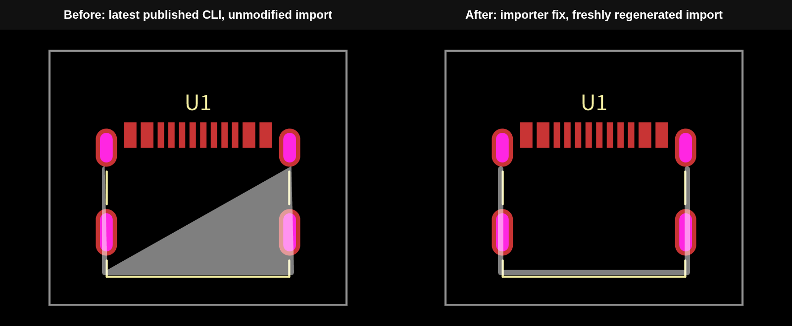
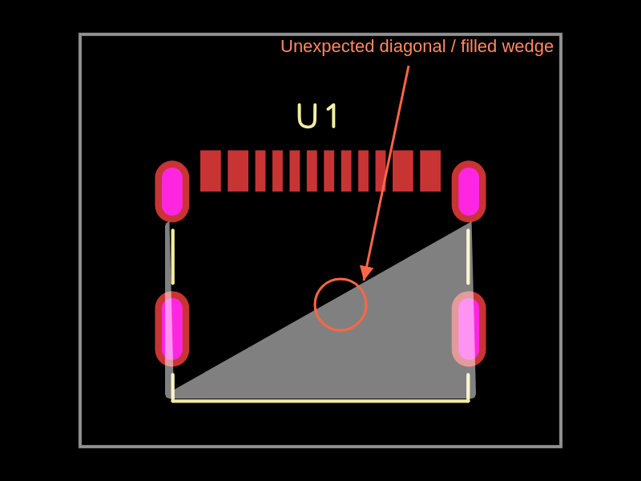

# I-007: EasyEDA repeated SVG arguments corrupt the USB4215 fabrication region

**Confirmed import defect**, independently reproduced on 2026-10-25 with the latest
published `@tscircuit/cli@0.1.2408` and `tscircuit@0.0.3016`.
Affected part: GCT USB4215-03-A, JLCPCB **C37616412**.
Original report: [issue.md, I-007](https://github.com/AnasSarkiz/rp2040-bldc-servo-controller/blob/main/issue.md).

## Fix validation on the stacked branch

The fix branch applies a version-pinned `patch-package` patch to the bundled
importer during `npm ci`, then runs the **same import and build commands**.
The generated TSX is regenerated by the importer, never hand-edited.



- The route changes from **12 to 19 points** and the 9.961452 mm diagonal disappears.
- Its filled area changes from **24.770837 to 4.760562 mm²**; fill and stroke
  semantics are preserved. The result agrees with the supplier's direct SVG.
- **106 other Circuit JSON records are identical**, including every pad, hole,
  schematic port, silkscreen and warning. Only the fabrication record and the
  source-filesystem digest change. Only the fabrication line changes in the
  importer-generated TSX; OBJ and STEP remain byte-identical.
- Eight regression tests exercise both actual importer helpers embedded in the
  installed CLI: **six fail before / all eight pass after**. Thirteen upstream
  parser/conversion/arc tests pass with the source patch.
- A clean `npm ci` applies the patch successfully. Re-import and PCB build exit 0;
  `npm run verify` checks the complete output invariants and changed PCB SVG.
  Across runners, it compares all **105 deterministic circuit records**, excluding
  the optional datasheet-fetch failure diagnostic: present behind the local proxy,
  absent on GitHub CI. That diagnostic remains visible in native JSON and logs.

Current native output: [PCB SVG](repros/i-007-usbc-footprint/dist/index/pcb.svg),
[PNG](repros/i-007-usbc-footprint/dist/index/pcb.png),
[Circuit JSON](repros/i-007-usbc-footprint/dist/index/circuit.json).
Baseline output is preserved under
[`evidence/baseline/`](repros/i-007-usbc-footprint/evidence/baseline/).
See [fix provenance and upstream patch instructions](repros/i-007-usbc-footprint/fixes/README.md).

## Reproduce

```sh
cd repros/i-007-usbc-footprint
npm ci
export PATH="$PWD/node_modules/.bin:$PATH"
tsci import --jlcpcb C37616412 --download --use-exact-footprint
tsci build index.circuit.tsx --pcb-svgs --pcb-png
npm test
npm run verify
```

Requires Node 24+, npm and Bun. See [fixture README](repros/i-007-usbc-footprint/README.md)
for evidence regeneration commands. The fresh project is independent of the
controller circuit and its imports. Its complete circuit is:

```tsx
import { USB4215_03_A } from "./imports/USB4215_03_A/USB4215_03_A"

export default () => (
  <board width="14mm" height="12mm">
    <USB4215_03_A name="U1" />
  </board>
)
```

## Expected and actual

Expected: preserve the supplier's thin, U-shaped, filled document-layer region,
including all the repeated line coordinates and rounded arcs. The open body
interior must stay empty. Actual: a large gray filled wedge with a diagonal
through the body. This is already in the imported TSX before any rendering.



| Evidence | Location |
| --- | --- |
| Baseline CLI PCB SVG / PNG | [pcb.svg](repros/i-007-usbc-footprint/evidence/baseline/pcb.svg), [pcb.png](repros/i-007-usbc-footprint/evidence/baseline/pcb.png) |
| Baseline complete Circuit JSON | [circuit.json](repros/i-007-usbc-footprint/evidence/baseline/circuit.json) |
| Extracted fabrication record / measured segments | [fabrication.json](repros/i-007-usbc-footprint/evidence/baseline/fabrication.json), [geometry.json](repros/i-007-usbc-footprint/evidence/baseline/geometry.json) |
| Isolated fabrication layer | [fabrication.svg](repros/i-007-usbc-footprint/evidence/baseline/fabrication.svg), [fabrication.png](repros/i-007-usbc-footprint/evidence/baseline/fabrication.png) |
| Independent supplier JSON / literal region | [easyeda-C37616412.json](repros/i-007-usbc-footprint/evidence/easyeda-C37616412.json), [source-document-region.txt](repros/i-007-usbc-footprint/evidence/source-document-region.txt) |
| Supplier path rendered directly by SVG | [source-document-region.svg](repros/i-007-usbc-footprint/evidence/source-document-region.svg) |
| CLI version, import and build logs | [versions.txt](repros/i-007-usbc-footprint/evidence/versions.txt), [import.log](repros/i-007-usbc-footprint/evidence/import.log), [build.log](repros/i-007-usbc-footprint/evidence/build.log) |

The baseline JSON contains exactly one source component, 12 SMT pads, four plated shell
holes, one fabrication region, **zero electrical traces and zero error records**.
The fabrication record is `pcb_fabrication_note_path_0`, layer `top`,
`is_filled:true`, `has_stroke:false`, `stroke_width:0`. Its 12-point route includes:

```json
[
  {"x": -4.272991200000092, "y": -4.348041800000033},
  {"x":  4.399991200000045, "y":  0.5519483999999011}
]
```

These consecutive points (indices 9→10) introduce a **9.961452 mm** diagonal.
The filled region makes the corruption especially visible; this is not a copper
trace or an intentional centerline. Baseline imported TSX SHA-256:
`179de42e8764eea61771b762acfdfd17495fc6986f2dce79f888abaf16cf9af7`.
It independently matches the original controller import, without copying it.

## Manufacturer drawing comparison

Compared visually against [GCT's official USB4215 mechanical drawing](https://gct.co/files/drawings/usb4215.pdf),
page 1, revision A, drawing date **26 April 2024**, already archived at
[datasheets/usb4215.pdf](datasheets/usb4215.pdf).
The archived PDF hash matches the repository's original download manifest:
`1659ba00769b9b774a033fac72cb2f3bfc481a3272c53f34e87520f33635a9e1`.
A fresh web fetch was unavailable; this comparison used the actual readable PDF,
not search text. [Rendered page 1](repros/i-007-usbc-footprint/evidence/manufacturer-drawing-page-1.png).

The top/body drawing shows a rectangular shell, nominal **8.94 × 6.50 mm**.
The component-side recommended PCB layout has axis-aligned body boundaries,
**8.64 mm** between shell-hole columns, **4.00 mm** between hole rows and
**0.50 mm** signal pitch. The imported hole columns are 8.639810 mm apart, rows
3.999992 mm apart, and inner pitch approximately 0.5 mm. Neither the PCB layout
nor the top view shows a body-spanning diagonal.

The supplier's layer-12 graphic is a U-shaped marking, about **9.054 × 5.154 mm**;
it is not a dimensionally exact substitute for GCT's complete 8.94 × 6.50 mm
body. Fixing the parser must preserve that supplier geometry, not invent a new
outline from the drawing. This investigation does not certify mechanical fit
or reconcile that separate representation difference.

## Responsible package and root cause

Primary owner: **`easyeda` (`tscircuit/easyeda-converter`), version 0.0.381**, bundled
in the released CLI. Relevant upstream revision:
[`00905fef07baf2e67f5f0ed64457f3b4c852f87e`](https://github.com/tscircuit/easyeda-converter/tree/00905fef07baf2e67f5f0ed64457f3b4c852f87e).

1. [`lib/utils/expand-easyeda-path-data.ts`](https://github.com/tscircuit/easyeda-converter/blob/00905fef07baf2e67f5f0ed64457f3b4c852f87e/lib/utils/expand-easyeda-path-data.ts)
   tokenizes M/L/A/Z commands but consumes only `values[0..1]` for M/L and the
   first seven numbers for A. SVG permits repeated parameter groups after one
   command letter. This source uses them in **both L and A**.
2. The supplier's `SOLIDREGION~12`, ID `gge456`, includes:
   `L 3980.2757 3011.5906 4013.9213 3011.5906 4013.9213 2992.7993`.
   The two later line destinations disappear. Each of two 14-number A commands
   also loses its second arc. Later surviving points are joined diagonally.
3. [`handleFabricationNoteSolidRegion`](https://github.com/tscircuit/easyeda-converter/blob/00905fef07baf2e67f5f0ed64457f3b4c852f87e/lib/convert-easyeda-json-to-tscircuit-soup-json.ts)
   converts the resulting points into a closed fabrication region;
   `generate-footprint-tsx.ts` serializes those already-wrong points.
4. `@tscircuit/core` carries the same geometry into Circuit JSON and
   `circuit-to-svg` faithfully renders its filled polygon. Rendering the original
   EasyEDA `d` string directly produces the intended U shape, proving that the
   bad diagonal was introduced during conversion rather than by the renderer.

The fix should iterate **all** complete argument groups (pairs for M/L, groups
of seven for A), update the current endpoint after each group, and preserve the
existing arc approximation and fill semantics. No part-specific coordinate
replacement, imported-definition edit, JSON edit, layer hiding, or renderer
suppression is necessary. A dependency-only override of `easyeda` cannot fix
this release because its implementation is embedded in the CLI bundle.

## Validation limits

Import and PCB build succeeded (exit 0). Expected missing pin-metadata and sheet
warnings remain visible in the logs. Datasheet enrichment was blocked by this
environment's network policy. No electrical wiring, routing, mechanical-fit
approval, registry publication or main-branch modification is part of this repro.
